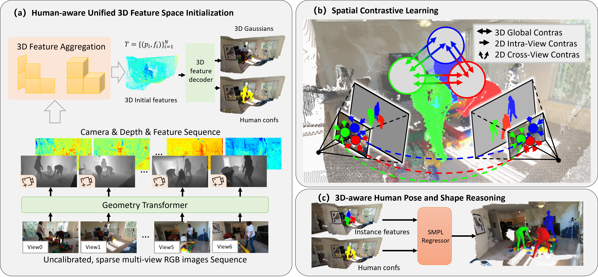
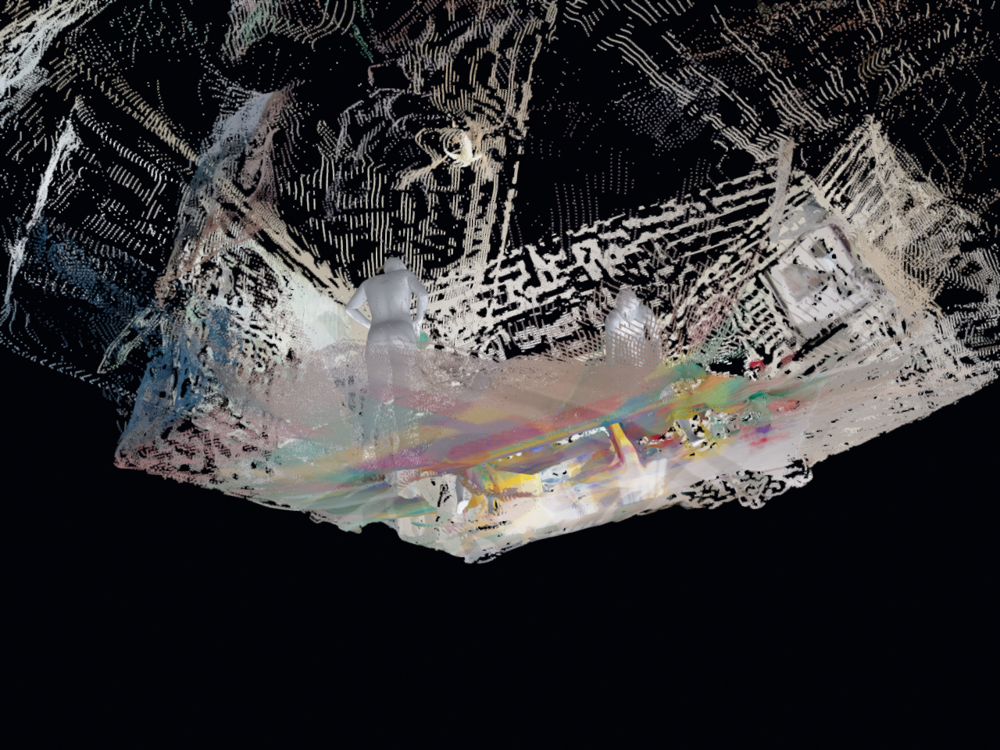
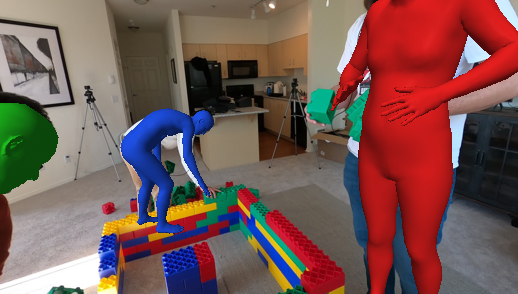
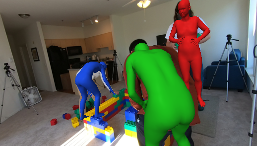
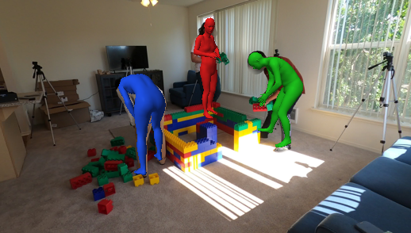
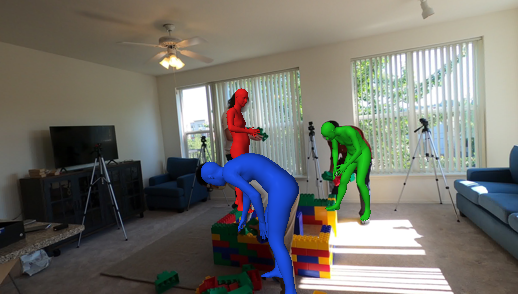
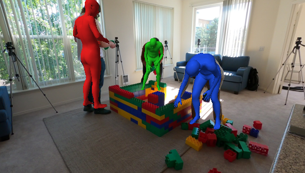
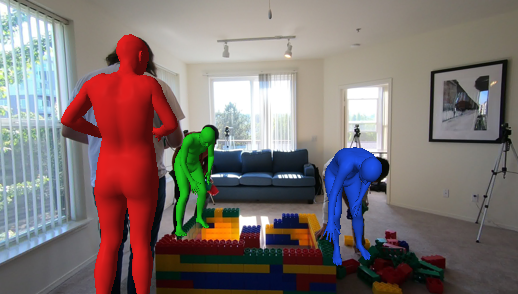

# FMMR: Feed-Forward Multi-view Multi-person Reconstruction with Contrastive Human-Aware 3D Representation

Multi-person SMPL mesh reconstruction from uncalibrated multi-view RGB images.

[Yuanwang Yang*](https://yywqwq.github.io/), [Buzhen Huang*](https://www.buzhenhuang.com/), Zongxuan Ren, [Jing Huang](https://jinghuang.site/), [Kun Li<sup>#</sup>](https://cic.tju.edu.cn/faculty/likun/index.html)

*International Journal of Computer Vision*, 134, Article 414, 2026.

[\[Project\]](https://cic.tju.edu.cn/faculty/likun/projects/FMMR/index.html) [\[Paper\]](https://doi.org/10.1007/s11263-026-03000-0)

<!-- Add project page and checkpoint download URL before publication. -->



## Installation

Requires an NVIDIA GPU with CUDA and bfloat16 support. Run from the repository root:

```bash
conda create -n fmmr python=3.10
conda activate fmmr
pip install -r requirements.txt
export PYTHONPATH="$PWD/third_party/dinov3:$PYTHONPATH"
```

On Windows PowerShell, replace the last command with:

```powershell
$env:PYTHONPATH = "$(Get-Location)/third_party/dinov3;$env:PYTHONPATH"
```

## Getting Started

### 1. Prepare model files

Obtain the body models from the [SMPL website](https://smpl.is.tue.mpg.de/) under its applicable terms. Prepare the following files:

```text
ckpt/
├── fmmr_pipeline.pth
├── dinov3/
│   └── dinov3_vits16_pretrain_lvd1689m-08c60483.pth
├── romp/
│   ├── ROMP.pkl
│   └── SMPL_NEUTRAL.pth
└── smpl/
    └── models/
        ├── SMPL_NEUTRAL.pkl
        ├── SMPL_MALE.pkl
        └── SMPL_FEMALE.pkl
```

Obtain the FMMR checkpoint from the maintainers and the DINOv3 / ROMP weights from their respective projects.

### 2. Prepare multi-view images

Place images of the same scene at the same time directly inside one directory:

```text
input/0000/
├── cam01.jpg
├── cam02.jpg
└── cam03.jpg
```

Use at least two views of the same scene; up to six views are selected by default.

### 3. Run inference

```bash
python test.py --inputs ./input/0000 --output-dir ./output/0000 --device cuda:0
```

Other options use the defaults in `test.py`.

## Visualization

### Reconstructed scene



### Multi-view mesh reprojections

<p>
  
  
  
</p>
<p>
  
  
  
</p>

## Citation

If you find this work useful, please cite:

Yuanwang Yang, Buzhen Huang, Zongxuan Ren, Jing Huang, Kun Li. "Feed-Forward Multi-view Multi-person Reconstruction with Contrastive Human-Aware 3D Representation". *International Journal of Computer Vision*, 134, Article 414, 2026. [DOI: 10.1007/s11263-026-03000-0](https://doi.org/10.1007/s11263-026-03000-0).

```bibtex
@article{yang2026feedforward,
  author = {Yuanwang Yang and Buzhen Huang and Zongxuan Ren and Jing Huang and Kun Li},
  title = {Feed-Forward Multi-view Multi-person Reconstruction with Contrastive Human-Aware {3D} Representation},
  journal = {International Journal of Computer Vision},
  volume = {134},
  eid = {414},
  year = {2026},
  doi = {10.1007/s11263-026-03000-0}
}
```

## Acknowledgments

FMMR uses code or models from the following projects. We thank their authors for making these resources available.

- [VGGT](https://github.com/facebookresearch/vggt)
- [DINOv3](https://github.com/facebookresearch/dinov3)
- [ROMP](https://github.com/Arthur151/ROMP)
- [SMPL](https://smpl.is.tue.mpg.de/)

## License

The original FMMR code is released under the [MIT License](LICENSE).

Third-party code and assets retain their respective licenses. See [LICENSE.txt](LICENSE.txt) for VGGT and [third_party/dinov3/LICENSE.md](third_party/dinov3/LICENSE.md) for DINOv3. External model weights, SMPL assets and datasets remain subject to their respective terms.
